  

I'm a software engineer (full-stack), working mostly in **Python** and **TypeScript**. My day job is building and running the internal platforms of an energy-tech company: the service desk, company-wide sign-in, document workflows and production dashboards. On top of that I build the AI layer: **MCP connectors** that let Claude work with these systems on behalf of each employee.

After hours I go lower in the stack: Linux, developer tooling and desktop apps.

<picture>
  <source media="(prefers-color-scheme: dark)" srcset="assets/stats-dark.svg">
  
</picture>

## 💼 Work

Private repositories, so here is what I build instead of links.

<picture>
  <source media="(prefers-color-scheme: dark)" srcset="assets/work-dark.svg">
  
</picture>

## 🤖 AI integrations

I build **MCP servers** that connect company systems to Claude: over **100 tools** in production, each one acting with the signed-in employee's own permissions.

<picture>
  <source media="(prefers-color-scheme: dark)" srcset="assets/ai-dark.svg">
  
</picture>

<b>More on how it's built</b>

 

- **Built for real-world APIs.** A Postgres mirror with webhooks and incremental sync to live under a 1 request/second limit, OAuth 2.0 with refresh-token rotation, Prometheus metrics, backups.
- **AI-first workflow.** Claude Code as a pair programmer and parallel agent sessions in separate git worktrees. Every change still goes through review, tests and CI.

## 🛠️ Side projects

  <picture><source media="(prefers-color-scheme: dark)" srcset="assets/project-nya-os-dark.svg"></picture>
  <picture><source media="(prefers-color-scheme: dark)" srcset="assets/project-kitsu-code-dark.svg"></picture>

  <picture><source media="(prefers-color-scheme: dark)" srcset="assets/project-nya-browser-dark.svg"></picture>
  <picture><source media="(prefers-color-scheme: dark)" srcset="assets/project-deb-installer-dark.svg"></picture>

## 🧰 Stack

<picture>
  <source media="(prefers-color-scheme: dark)" srcset="https://skillicons.dev/icons?i=python%2Cts%2Cjs%2Cbash%2Cfastapi%2Cnestjs%2Cnodejs%2Cprisma%2Creact%2Cnextjs%2Cvite%2Ctailwind%2Celectron%2Cpostgres%2Credis%2Cdocker%2Cgithubactions%2Cnginx%2Cterraform%2Caws%2Cazure%2Clinux%2Cdebian%2Cqt%2Cgit&perline=13&theme=dark">
  
</picture>

    
